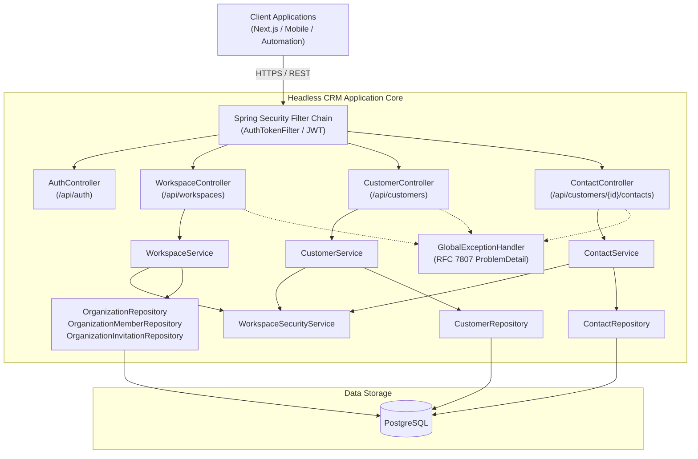

# 🚀 Headless CRM

[](https://openjdk.org/)
[](https://spring.io/projects/spring-boot)
[](http://localhost:8080/swagger-ui.html)
[](https://www.postgresql.org/)
[](https://datatracker.ietf.org/doc/html/rfc7807)
[](LICENSE)

> **A high-performance, developer-first Headless Customer Relationship Management (CRM) engine.**  
> Decoupled from rigid monolithic user interfaces, Headless CRM empowers teams to power custom web apps (Next.js, React, Vue), native mobile experiences, automated pipelines, and internal tools through a clean, secure, and intuitive RESTful API.

---

## 🌟 Highlights

- **🔒 Stateless JWT Authentication**: Secure signup and login flows utilizing industry-standard JSON Web Tokens (`jjwt-api`) and BCrypt password encryption, with auto-provisioned primary workspaces.
- **🏢 Multi-Tenant Workspaces & RBAC**: Shared team organizations with four-tier role-based access control (`OWNER`, `ADMIN`, `MEMBER`, `READ_ONLY`), member management, invitations, and dynamic `X-Workspace-Id` context resolution.
- **👥 Customer Lifecycle Management**: Full CRUD operations for customer records scoped to team workspaces, featuring soft-deletes (`deleted` flag & timestamp).
- **📇 Nested Contact Associations**: Manage hierarchical customer contacts (`/api/customers/{customerId}/contacts`) with duplicate email guards per customer.
- **📑 Interactive OpenAPI 3 / Swagger UI**: Built-in interactive API exploration with pre-configured Bearer token authentication.
- **⚡ RFC 7807 Standardized Errors**: Modern `application/problem+json` error responses with detailed field-level validation diagnostics and access denial specifications.
- **📈 Paginated & Sorted Queries**: Native Spring Data JPA pagination and sorting on customer and contact listings.
- **🧪 Comprehensive Test Coverage**: 100% unit and integration test coverage across controllers, services, and security layers with MockMvc and Mockito.

---

## 🏛 System Architecture



---

## 🚀 Getting Started

### Prerequisites

- **Java Development Kit (JDK)**: Version 17 or higher
- **Maven**: Version 3.8+ (or use `./mvnw`)
- **PostgreSQL**: 14+ database instance

### 1. Clone & Configure

```bash
git clone https://github.com/your-username/headless-crm.git
cd headless-crm
```

Configure your PostgreSQL database connection in `src/main/resources/application.yaml`:

```yaml
spring:
  datasource:
    url: jdbc:postgresql://localhost:5432/headless-crm
    username: <your_db_username>
    password: <your_db_password>
  jpa:
    hibernate:
      ddl-auto: update
```

### 2. Build and Run

```bash
# Build the project and run test suite
mvn clean test

# Launch the Spring Boot application
mvn spring-boot:run
```

The application will start on `http://localhost:8080`.

---

## 📖 Interactive API Documentation (Swagger UI)

Explore, test, and generate client SDKs directly in the browser:

- **Swagger UI**: [http://localhost:8080/swagger-ui.html](http://localhost:8080/swagger-ui.html)
- **OpenAPI JSON Spec**: [http://localhost:8080/v3/api-docs](http://localhost:8080/v3/api-docs)

> **Tip:** In Swagger UI, click **Authorize** at the top right and enter `Bearer <your_token>` generated from `/api/auth/login` to unlock protected endpoints.

---

## 📡 API Reference Overview

### 🔐 Authentication

| Method | Endpoint           | Description                       | Auth Required |
| ------ | ------------------ | --------------------------------- | ------------- |
| `POST` | `/api/auth/signup` | Register a new user               | No            |
| `POST` | `/api/auth/login`  | Authenticate and obtain JWT token | No            |

### 🏢 Workspaces & Team Collaboration

| Method   | Endpoint                                             | Description                                                     | Auth Required |
| -------- | ---------------------------------------------------- | --------------------------------------------------------------- | ------------- |
| `POST`   | `/api/workspaces`                                    | Create new workspace (creator becomes `OWNER`)                  | Yes (Bearer)  |
| `GET`    | `/api/workspaces`                                    | List all workspaces for authenticated user                      | Yes (Bearer)  |
| `GET`    | `/api/workspaces/{workspaceId}`                      | Get workspace details                                           | Yes (Bearer)  |
| `PUT`    | `/api/workspaces/{workspaceId}`                      | Update workspace details (requires `ADMIN` or `OWNER`)          | Yes (Bearer)  |
| `DELETE` | `/api/workspaces/{workspaceId}`                      | Delete workspace and associated data (requires `OWNER`)         | Yes (Bearer)  |
| `GET`    | `/api/workspaces/{workspaceId}/members`              | List workspace members and their assigned roles                 | Yes (Bearer)  |
| `POST`   | `/api/workspaces/{workspaceId}/members`              | Add registered user directly (requires `ADMIN` or `OWNER`)      | Yes (Bearer)  |
| `PUT`    | `/api/workspaces/{workspaceId}/members/{memberId}`   | Update member role (`OWNER`, `ADMIN`, `MEMBER`, `READ_ONLY`)    | Yes (Bearer)  |
| `DELETE` | `/api/workspaces/{workspaceId}/members/{memberId}`   | Remove member or leave workspace                                | Yes (Bearer)  |
| `POST`   | `/api/workspaces/{workspaceId}/invitations`          | Invite member via email with role (requires `ADMIN` or `OWNER`) | Yes (Bearer)  |
| `GET`    | `/api/workspaces/{workspaceId}/invitations`          | List pending invitations (requires `ADMIN` or `OWNER`)          | Yes (Bearer)  |
| `POST`   | `/api/workspaces/invitations/{invitationId}/accept`  | Accept workspace invitation                                     | Yes (Bearer)  |
| `POST`   | `/api/workspaces/invitations/{invitationId}/decline` | Decline workspace invitation                                    | Yes (Bearer)  |

### 👥 Customers

| Method   | Endpoint              | Description                       | Auth Required |
| -------- | --------------------- | --------------------------------- | ------------- |
| `POST`   | `/api/customers`      | Create a customer                 | Yes (Bearer)  |
| `GET`    | `/api/customers`      | List active customers (paginated) | Yes (Bearer)  |
| `GET`    | `/api/customers/{id}` | Get customer details by ID        | Yes (Bearer)  |
| `PUT`    | `/api/customers/{id}` | Update customer information       | Yes (Bearer)  |
| `DELETE` | `/api/customers/{id}` | Soft delete customer              | Yes (Bearer)  |

### 📇 Contacts

| Method   | Endpoint                                           | Description                | Auth Required |
| -------- | -------------------------------------------------- | -------------------------- | ------------- |
| `POST`   | `/api/customers/{customerId}/contacts`             | Add contact to customer    | Yes (Bearer)  |
| `GET`    | `/api/customers/{customerId}/contacts`             | List contacts for customer | Yes (Bearer)  |
| `GET`    | `/api/customers/{customerId}/contacts/{contactId}` | Get contact by ID          | Yes (Bearer)  |
| `PUT`    | `/api/customers/{customerId}/contacts/{contactId}` | Update contact details     | Yes (Bearer)  |
| `DELETE` | `/api/customers/{customerId}/contacts/{contactId}` | Delete contact             | Yes (Bearer)  |

### 📊 Pipelines & Stages

| Method   | Endpoint                          | Description                                          | Auth Required |
| -------- | --------------------------------- | ---------------------------------------------------- | ------------- |
| `POST`   | `/api/pipelines`                  | Create sales pipeline with custom stages             | Yes (Bearer)  |
| `GET`    | `/api/pipelines`                  | List pipelines for workspace                         | Yes (Bearer)  |
| `GET`    | `/api/pipelines/{id}`             | Get pipeline details with stages                     | Yes (Bearer)  |
| `PUT`    | `/api/pipelines/{id}`             | Update pipeline details and stages                   | Yes (Bearer)  |
| `DELETE` | `/api/pipelines/{id}`             | Delete pipeline (non-default & without active deals) | Yes (Bearer)  |
| `POST`   | `/api/pipelines/{id}/set-default` | Designate pipeline as workspace default              | Yes (Bearer)  |

### 💼 Deals & Opportunities

| Method   | Endpoint                | Description                                                   | Auth Required |
| -------- | ----------------------- | ------------------------------------------------------------- | ------------- |
| `POST`   | `/api/deals`            | Create a new deal / opportunity                               | Yes (Bearer)  |
| `GET`    | `/api/deals`            | List deals with filtering (pipeline, stage, customer, status) | Yes (Bearer)  |
| `GET`    | `/api/deals/{id}`       | Get deal details by ID                                        | Yes (Bearer)  |
| `PUT`    | `/api/deals/{id}`       | Update deal details                                           | Yes (Bearer)  |
| `PATCH`  | `/api/deals/{id}/stage` | Advance / move deal stage (auto win/loss tracking)            | Yes (Bearer)  |
| `DELETE` | `/api/deals/{id}`       | Soft delete deal (requires `ADMIN` or `OWNER`)                | Yes (Bearer)  |

### 📅 Activities (Calls, Meetings, Notes, Tasks)

| Method   | Endpoint                        | Description                                                   | Auth Required |
| -------- | ------------------------------- | ------------------------------------------------------------- | ------------- |
| `POST`   | `/api/activities`               | Log call, meeting, note, or create task                       | Yes (Bearer)  |
| `GET`    | `/api/activities`               | List activities with filtering (type, status, customer, deal) | Yes (Bearer)  |
| `GET`    | `/api/activities/{id}`          | Get activity details by ID                                    | Yes (Bearer)  |
| `PUT`    | `/api/activities/{id}`          | Update activity details or reschedule                         | Yes (Bearer)  |
| `PATCH`  | `/api/activities/{id}/complete` | Mark activity/task as completed                               | Yes (Bearer)  |
| `DELETE` | `/api/activities/{id}`          | Delete activity                                               | Yes (Bearer)  |

### 📜 Aggregate Relationship History (Timeline)

| Method | Endpoint                               | Description                                           | Auth Required |
| ------ | -------------------------------------- | ----------------------------------------------------- | ------------- |
| `GET`  | `/api/timeline`                        | Workspace-wide aggregated chronological activity feed | Yes (Bearer)  |
| `GET`  | `/api/timeline/customers/{customerId}` | Complete relationship history feed for a customer     | Yes (Bearer)  |
| `GET`  | `/api/timeline/deals/{dealId}`         | Complete relationship interaction feed for a deal     | Yes (Bearer)  |

---

## 🛠 Quick Walkthrough (cURL)

### 1. Register & Login

```bash
# Register User
curl -X POST http://localhost:8080/api/auth/signup \
  -H "Content-Type: application/json" \
  -d '{"name": "Admin User", "email": "admin@example.com", "password": "SecretPassword123"}'

# Login to get JWT
TOKEN=$(curl -s -X POST http://localhost:8080/api/auth/login \
  -H "Content-Type: application/json" \
  -d '{"email": "admin@example.com", "password": "SecretPassword123"}' | grep -o '"token":"[^"]*' | cut -d'"' -f4)
```

### 2. Create a Customer

```bash
curl -X POST http://localhost:8080/api/customers \
  -H "Authorization: Bearer $TOKEN" \
  -H "Content-Type: application/json" \
  -d '{
    "firstName": "Acme",
    "lastName": "Corporation",
    "email": "contact@acme.com",
    "phone": "+1-555-0199",
    "address": "100 Innovation Way, Tech City"
  }'
```

### 3. Add a Contact to Customer

```bash
curl -X POST http://localhost:8080/api/customers/<CUSTOMER_UUID>/contacts \
  -H "Authorization: Bearer $TOKEN" \
  -H "Content-Type: application/json" \
  -d '{
    "firstName": "Jane",
    "lastName": "Smith",
    "email": "jane.smith@acme.com",
    "phone": "+1-555-0142"
  }'
```

---

## ⚠️ Standardized Error Responses (RFC 7807)

All non-2xx responses adhere to the standard `application/problem+json` specification:

```json
{
  "type": "https://api.headlesscrm.com/errors/not-found",
  "title": "Resource Not Found",
  "status": 404,
  "detail": "Customer not found with id: 613bd9c2-5d7d-4d83-a6bf-8a7fd95e3b81",
  "instance": "/api/customers/613bd9c2-5d7d-4d83-a6bf-8a7fd95e3b81",
  "timestamp": "2026-11-04T17:45:00.123456Z"
}
```

Validation errors contain field-level specifics:

```json
{
  "type": "https://api.headlesscrm.com/errors/validation-error",
  "title": "Validation Failed",
  "status": 400,
  "invalidFields": {
    "email": "must be a well-formed email address",
    "firstName": "must not be blank"
  },
  "timestamp": "2026-11-04T17:45:00.123456Z"
}
```

---

## 🗺 Product Roadmap

Development follows our comprehensive milestone plan outlined in [`ROADMAP_20261104.md`](ROADMAP_20261104.md):

- [x] **Phase 1: Complete Core CRUD & Robust API Design**
  - [x] Customer full lifecycle with soft delete
  - [x] Nested contact associations
  - [x] RFC 7807 Problem Details error handling
  - [x] SpringDoc OpenAPI / Swagger UI integration
- [x] **Phase 2: Multi-Tenancy & Team Collaboration**
  - [x] Organization & workspace scoping with `X-Workspace-Id` context resolution
  - [x] Team invitations and membership lifecycle (`OrganizationInvitation`, `OrganizationMember`)
  - [x] Granular RBAC (`OWNER`, `ADMIN`, `MEMBER`, `READ_ONLY`) with `WorkspaceSecurityService`
  - [x] Standardized RFC 7807 403 Forbidden error handling
- [x] **Phase 3: CRM Domain Expansion**
  - [x] Deals & Pipeline stages (`Lead`, `Qualified`, `Proposal`, `Won`, `Lost`)
  - [x] Activity timelines (calls, meetings, tasks)
  - [x] Dynamic JSONB custom fields
- [ ] **Phase 4: Headless Integration & Developer Ecosystem**
  - [ ] Machine-to-Machine (M2M) API keys
  - [ ] Outgoing Webhooks (Transactional Outbox)
  - [ ] Full-text search & Specification filters
- [ ] **Phase 5: Production Hardening & CI/CD**
  - [ ] Flyway version-controlled migrations
  - [ ] Multi-stage Docker containerization
  - [ ] GitHub Actions CI workflow

---

## 📄 License

This project is licensed under the [Apache 2.0 License](LICENSE).
